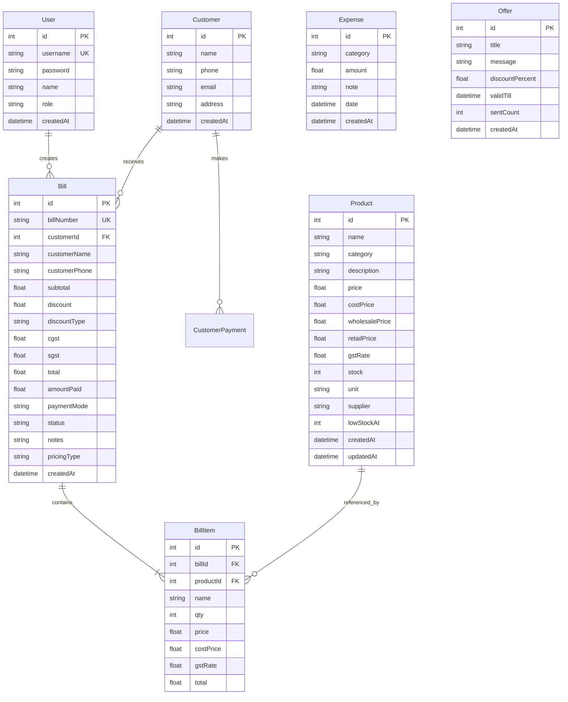

# Product Requirement Document (PRD)
## Maruthi Furnitures & Mattresses — Enterprise Shop Management & POS System

---

## 1. Executive Summary
**Maruthi Furnitures & Mattresses** is a specialized retail and wholesale Point-of-Sale (POS), inventory management, and business analytics system built for furniture, mattress, air cooler, and steel almirah establishments. 

The software streamlines daily counter sales, inventory tracking, wholesale-versus-retail margin calculations, operating expense tracking, customer debt/balance collection, and customer marketing broadcasts via WhatsApp. The application is delivered both as a web-accessible system (via an Apache reverse proxy on port 80) and as a native Windows desktop executable (`MaruthiFurnitures.exe`).

---

## 2. Business Context & Objectives
- **Business Name:** Maruthi Furnitures & Mattresses
- **Location:** Bypass Road, Mytri Vanam, Beside RS Metro Garden, Siddipet, Telangana - 502103
- **Contact:** +91 9908267125 | maruthifurnitures001@gmail.com
- **Core Product Lines:** Air Coolers, Steel Dressing Tables, Rebonded & PU Foam Mattresses, Steel Almirahs (Wardrobes), Sofa Cushion Sets.

### Core Problems Solved:
1. **Dual-Tier Pricing:** Eliminates manual guesswork when quoting wholesale prices to dealers versus retail prices to walk-in customers.
2. **Margin Transparency:** Solves opaque profitability by calculating real-time gross margin and net margin after accounting for operational expenses (rent, freight, electricity, hamali).
3. **Credit / Balance Tracking:** Keeps an exact log of customer dues, partial payments, and payment modes.
4. **Marketing Disconnect:** Enables one-click promotional broadcasts to existing customers over WhatsApp without external recurring SaaS costs.
5. **Frictionless Desktop Deployment:** Operates offline-first on Windows with local MySQL persistence and automated daemon management.

---

## 3. System Architecture & Tech Stack

```
+-------------------------------------------------------------+
|                     Client Presentation                     |
|  +---------------------------+  +------------------------+  |
|  | Native App (Edge App Mode)|  | Web Browser (Port 80)  |  |
|  +-------------+-------------+  +-----------+------------+  |
+----------------|----------------------------|---------------+
                 |                            |
                 v                            v
+-------------------------------------------------------------+
|               Apache HTTP Server (Port 80)                  |
|               Reverse Proxy & WebSocket Tunnel              |
+------------------------------+------------------------------+
                               |
                               v
+-------------------------------------------------------------+
|               Next.js 14 App Server (Port 3000)             |
|   React 18 | Tailwind CSS | TypeScript | Route Handlers     |
+------------------------------+------------------------------+
                               |
                               v
+-------------------------------------------------------------+
|                      Prisma ORM Client                      |
+------------------------------+------------------------------+
                               |
                               v
+-------------------------------------------------------------+
|                MySQL Database (Port 3306)                   |
|                   maruthi_furnitures                        |
+-------------------------------------------------------------+
```

### Technology Matrix:
- **Frontend / Framework:** Next.js 14 (App Router), React 18, Tailwind CSS, TypeScript 5
- **ORM & Data Layer:** Prisma ORM 5.22
- **Database Engine:** MySQL 8.x (running locally via XAMPP)
- **Web Server / Reverse Proxy:** Apache 2.4 (mod_proxy, mod_proxy_http, mod_proxy_wstunnel)
- **Desktop Wrapper:** Custom Native Windows Executable (.NET 4.0 C# launcher + Windows Script Host)
- **Document & Print Engine:** Native Print Stylesheet + jsPDF / jsPDF-AutoTable

---

## 4. Database Schema Specification



---

## 5. Functional Requirements & Feature Modules

### 5.1 Dynamic Inventory & Multi-Tier Pricing (`/products`)
- **Two-Tier Pricing:** Every product stores `wholesalePrice` (dealer rate) and `retailPrice` (walk-in rate).
- **Profit Margin Column:** Automatically computes:
  $$\text{Margin Amount (₹)} = \text{Retail Price} - \text{Wholesale Price}$$
  $$\text{Margin \%} = \left(\frac{\text{Retail Price} - \text{Wholesale Price}}{\text{Retail Price}}\right) \times 100$$
- **Category Taxonomy:** Air Cooler, Dressing Table, Mattress, Almirah, Sofa Cushions, General.
- **Stock Thresholds:** Configurable `lowStockAt` threshold with automated warning badges.
- **Catalog Management:** In-app modals for adding, editing, and deleting inventory items.

### 5.2 Point-of-Sale (POS) & Billing Engine (`/billing/new`)
- **Pricing Mode Switch:** Instant toggle between **🛍️ Retail Pricing** and **🏢 Wholesale Pricing**. Switching tiers recalculates all row items in real-time.
- **Live Profit Indicator:** Displays live estimated net profit and margin percentage to the shopkeeper before generating the bill.
- **Tax Calculation:**
  $$\text{Taxable Subtotal} = \text{Subtotal} - \text{Discount}$$
  $$\text{CGST} = \sum \frac{\text{Line Taxable} \times \text{GST \%}}{200}, \quad \text{SGST} = \text{CGST}$$
  $$\text{Grand Total} = \text{Taxable Subtotal} + \text{CGST} + \text{SGST}$$
- **Flexible Payments:** Cash, UPI (PhonePe / GPay), Card, Bank Transfer, Cheque with partial payment and balance due tracking.

### 5.3 Invoice Tracking & Lifecycle Management (`/billing`)
- **Invoice Numbering:** Deterministic format `MF-YYYY-XXXX` (e.g. `MF-2026-0001`).
- **Instant Search:** Search across invoice numbers, customer names, or phone numbers.
- **Status Workflows:** `Paid` (Full payment received), `Partial` (Dues pending), `Pending` (Credit bill).
- **In-Place Invoice Updating:** Modal to record subsequent payments, update payment modes, and add receipt notes.
- **Printable Tax Invoices (`/billing/[id]`):** Branded layout featuring the official Maruthi logo, GST breakdown, customer bill-to info, and shop terms.

### 5.4 Expense & Overall Margin Tracker (`/expenses`)
- **Cost of Goods Sold (COGS):** Total wholesale cost of billed merchandise:
  $$\text{COGS} = \sum (\text{item.costPrice} \times \text{item.qty})$$
- **Gross Profit:**
  $$\text{Gross Profit} = \text{Total Revenue} - \text{COGS}$$
- **Net Margin Engine:**
  $$\text{Net Profit} = \text{Gross Profit} - \text{Operating Expenses}$$
  $$\text{Overall Net Margin \%} = \left(\frac{\text{Net Profit}}{\text{Total Revenue}}\right) \times 100$$
- **Expense Categorization:** Shop Rent, Electricity, Freight & Transport, Hamali & Labor, Salaries, Refreshments, Maintenance.

### 5.5 Customer CRM & Marketing Broadcast (`/offers` & `/customers`)
- **Promotional Offer Engine:** Compose custom offers with validity windows and discount percentages.
- **One-Click WhatsApp Dispatch:** Generates verified click-to-chat links:
  `https://wa.me/91[phone]?text=[encodedMessage]`
- **Audience Management:** Automatically tracks recipient counts and stores campaign archives.

### 5.6 Native Desktop Integration (`MaruthiFurnitures.exe`)
- **Single-Executable Launcher:** Compiled C# binary with embedded Maruthi application icon.
- **Automated Dependency Health Checks:**
  1. Detects and starts `mysqld.exe` if not running.
  2. Detects and starts `httpd.exe` (Apache) if not running.
  3. Probes port 3000 via TCP and launches the background Next.js server if not active.
  4. Waits until port 3000 responds before opening Edge/Chrome in dedicated application mode (`--app=http://localhost/`).
- **Auto-Boot Resiliency:** VBScript registered in Windows Startup folder (`MaruthiServer.vbs`) for automated startup on reboot.

---

## 6. Verified Product Catalog (29 Master Products)

### Air Coolers
| Item | Wholesale | Retail | Margin | Margin % | Stock |
|---|---|---|---|---|---|
| Cool Xpert Plain (B) | ₹3,400 | ₹6,500 | +₹3,100 | 47.7% | 14 pcs |
| Cool Xpert Plastic Top (P. Top) | ₹3,450 | ₹6,700 | +₹3,250 | 48.5% | 12 pcs |
| Cool Xpert Tully | ₹3,500 | ₹6,900 | +₹3,400 | 49.3% | 14 pcs |
| Everest Air Cooler | ₹3,300 | ₹4,500 | +₹1,200 | 26.7% | 12 pcs |

### Dressing Tables
| Item | Wholesale | Retail | Margin | Margin % | Stock |
|---|---|---|---|---|---|
| 2 Feet Self Polish | ₹2,550 | ₹4,500 | +₹1,950 | 43.3% | 4 pcs |
| 2 Feet Polish Box | ₹2,450 | ₹4,200 | +₹1,750 | 41.7% | 4 pcs |
| 2 Feet Beeding | ₹1,950 | ₹3,500 | +₹1,550 | 44.3% | 4 pcs |
| 2½ Feet Special Beeding | ₹3,300 | ₹6,000 | +₹2,700 | 45.0% | 2 pcs |
| 2½ Feet Polish Double Door | ₹2,950 | ₹6,500 | +₹3,550 | 54.6% | 4 pcs |

### Mattresses & Cushions
| Item | Wholesale | Retail | Margin | Margin % | Stock |
|---|---|---|---|---|---|
| 72x36x6" R/B Eurotop | ₹4,025 | ₹14,500 | +₹10,475 | 72.2% | 4 pcs |
| 75x36x6" R/B Eurotop (24mm) | ₹4,125 | ₹14,500 | +₹10,375 | 71.6% | 4 pcs |
| 75x36x6" R/B Regular | ₹4,125 | ₹13,500 | +₹9,375 | 69.4% | 4 pcs |
| 72x36x5" 32D (J) (20mm) | ₹3,125 | ₹14,000 | +₹10,875 | 77.7% | 4 pcs |
| 75x36x5" 32D (J) | ₹3,225 | ₹15,000 | +₹11,775 | 78.5% | 4 pcs |
| 75x36x5" 28D (J) (16mm) | ₹2,625 | ₹9,500 | +₹6,875 | 72.4% | 4 pcs |
| 72x36x5" 28D (J) | ₹2,575 | ₹9,500 | +₹6,925 | 72.9% | 2 pcs |
| 72x36x5" 28D (Satin) | ₹2,275 | ₹8,500 | +₹6,225 | 73.2% | 4 pcs |
| 75x36x5" 28D (Satin) | ₹2,325 | ₹8,500 | +₹6,175 | 72.6% | 4 pcs |
| 72x48x6" R/B Regular | ₹5,375 | ₹12,500 | +₹7,125 | 57.0% | 2 pcs |
| 72x48x5" 32D (J) | ₹4,175 | ₹9,000 | +₹4,825 | 53.6% | 1 pc |
| 75x48x5" 32D (J) | ₹4,300 | ₹9,500 | +₹5,200 | 54.7% | 1 pc |
| 75x36x4" E/P Foam | ₹1,350 | ₹3,000 | +₹1,650 | 55.0% | 4 pcs |
| Sofa Cushion Set 75x36x5" (3+1+1) | ₹1,850 | ₹6,000 | +₹4,150 | 69.2% | 6 sets |
| Sofa Cushion Set 75x48x5" (3+1+1) | ₹2,450 | ₹4,500 | +₹2,050 | 45.6% | 1 set |

### Steel Almirahs (Wardrobes)
| Item | Wholesale | Retail | Margin | Margin % | Stock |
|---|---|---|---|---|---|
| P.C 48 Almirah (with Mirror) | ₹12,500 | ₹18,500 | +₹6,000 | 32.4% | 3 pcs |
| P.C 46 Almirah (without Mirror) | ₹11,000 | ₹16,500 | +₹5,500 | 33.3% | 3 pcs |
| Family Almirah (Light 38) | ₹8,800 | ₹13,000 | +₹4,200 | 32.3% | 4 pcs |
| CR. 38 Almirah | ₹6,800 | ₹10,000 | +₹3,200 | 32.0% | 4 pcs |
| Mt-38 Almirah | ₹6,000 | ₹9,000 | +₹3,000 | 33.3% | 4 pcs |

---

## 7. Non-Functional & Security Requirements
- **Availability:** Offline-first architecture requiring zero external cloud dependencies.
- **Latency:** Sub-50ms query response times via local MySQL indexing.
- **Security:** Hashed / controlled admin credentials, scoped cookie session management, and restricted local port binding.
- **Data Integrity:** Foreign key constraints with cascade safeguards on `BillItem` and `CustomerPayment`.

---

## 8. Deployment & Operation Procedures
1. **Primary Launch:** Double-click `Maruthi Furnitures.lnk` on Windows Desktop or execute `MaruthiFurnitures.exe`.
2. **Web Browser Access:** Navigate to `http://localhost/` or `http://localhost:3000/`.
3. **Admin Login:**
   - **Username:** `admin`
   - **Password:** `admin123`
4. **Database Management:** MySQL accessible via XAMPP phpMyAdmin at `http://localhost/phpmyadmin/` (database: `maruthi_furnitures`).

